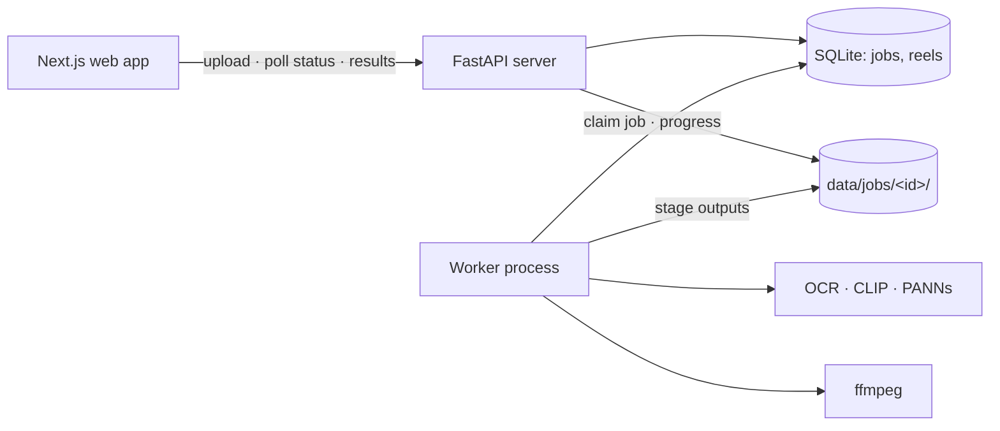

# Architecture — Reel: Automatic Cricket Highlight Generator

> Descriptive, not persuasive. The "why" for non-obvious choices lives in [`decisions/`](decisions/).
> Requirements: [`PRD.md`](PRD.md) · Background: [`research.md`](research.md)

## Stack
- **Frontend:** Next.js (App Router) + TypeScript + Tailwind CSS + shadcn/ui; native HTML5 `<video>`; Recharts for the excitement chart.
- **Backend:** Python 3.11, FastAPI + Uvicorn, Pydantic models, `uv` for dependency management.
- **Worker:** a separate Python process (`python -m reel.jobs.worker`) that runs the pipeline, one job at a time.
- **Database:** SQLite (jobs and reels tables only). Everything else is files under `data/`.
- **Hosting:** none. Runs on the developer's laptop (localhost); Google Colab for evaluation batches and classifier training.
- **Media:** ffmpeg / ffprobe (system binaries, called via subprocess).
- **Models (pretrained, CPU):**
  - OCR: RapidOCR (PaddleOCR PP-OCR models on ONNX Runtime).
  - Camera-shot type: CLIP ViT-B/32 via `open_clip` + a scikit-learn logistic-regression classifier trained on CLIP embeddings.
  - Crowd audio: PANNs CNN14 via `panns_inference` (AudioSet classes: Cheering, Applause, Crowd).
  - Camera-cut detection: PySceneDetect detectors run on low-resolution frames.
  - Loudness: librosa.
- **Testing:** pytest. Test videos are generated synthetically with ffmpeg; no real match footage is ever needed for tests.
- **Other services:** none. No cloud APIs at runtime; models are downloaded once into `data/models/`.

## System flow



- The browser talks to FastAPI directly (CORS for `localhost:3000`); uploads never pass through Next.js.
- The API only creates jobs, reports status and serves files. All heavy work happens in the worker.
- The frontend polls `GET /api/jobs/{id}` every 2 s while a job runs.

## Processing pipeline
Each stage reads earlier stages' files and writes its own into `data/jobs/<id>/`. A stage whose output file already exists and is valid is skipped. This makes it possible to resume after a crash, re-cut reels cheaply, and develop stages independently against saved files.

| # | Stage | Module | Does | Writes |
|---|---|---|---|---|
| 1 | `ingest` | `ingest` | ffprobe metadata; extract audio as 32 kHz mono WAV | `meta.json`, `audio.wav` |
| 2 | `locate_scorebox` | `scoreboard` | Seek to ~80 frames spread across the match (skipping the first/last 5 min); full-frame OCR; keep text matching score patterns (`\d{1,3}[/-]\d{1,2}`, `\d{1,2}\.\d`) whose position is stable; validate that readings increase plausibly over time | `scorebox.json` (box, confidence, sample reading, or `found: false`), `scorebox_preview.jpg` (a sample frame, saved even when not found) |
| 3 | `scan` | `ingest` | **The only full decode of the video.** One ffmpeg pass outputs (a) 4 fps low-res frames → camera-cut detection + one keyframe per shot; (b) 2 fps full-res crops of the score box (skipped if not found) | `shots.json` (boundaries), `keyframes/`, `score_crops/` |
| 4 | `read_score` | `scoreboard` | OCR text recognition only on crops that differ from the previous crop; parse runs/wickets/overs; match-state machine (see below); score-box visibility timeline | `score_readings.json` (raw OCR readings), `score_timeline.json`, `score_events.json` |
| 5 | `classify_shots` | `shots` | CLIP embedding per keyframe → classifier → `run_up` / `close_up` / `crowd` / `field` / `graphic` with probabilities | `shot_embeddings.npy` (cache), `shots.json` (labelled) |
| 6 | `audio` | `audio` | Per-second excitement: loudness z-score against a rolling 5-min median/MAD, plus PANNs P(cheering/applause/crowd); combined score in [0,1] | `excitement.csv` |
| 7 | `deliveries` | `deliveries` | A `run_up` shot with the score box visible = a delivery start (consecutive ones merged). Each score event is assigned to the latest delivery that started before it. `run_up` shots with the score box hidden before the next delivery = that delivery's replays | `deliveries.json` |
| 8 | `highlights` | `highlights` | Rate each delivery with the rules; attach reasons; compute clip start/end; select clips for the requested mode | `events.json`, `reel_plan_<mode>.json` |
| 9 | `render` | `render` | Cut each clip (re-encode, 720p H.264/AAC), draw the caption, 0.3 s fade in/out, generate the title card, concatenate | `reel_<mode>.mp4`, `clips/`, `summary.json` |

The default 5-minute reel runs stages 1–9. Requesting another mode re-runs only stages 8–9: the API creates a queued `Reel` row, and the worker claims queued reels the same way it claims jobs.

### Score-box detection (stage 2)
- A candidate region must contain parseable score-like text in **≥ 40%** of sampled frames.
- Its readings in time order must be plausible: runs and overs non-decreasing within an innings in **≥ 90%** of consecutive pairs.
- If several regions qualify, take the one with the most valid readings. If none qualifies, `found: false`; stages 4 and the score part of 7 are skipped, and highlights use audio + video signals only. The result page shows a notice.
- Both runs-wickets (`145/3`, Indian broadcasts) and wickets-runs (`3/145`, Australian) orders must be handled: the number that grows faster is runs.

### Match-state machine (stage 4)
- A new reading is accepted only after it appears in **≥ 2 consecutive** changed crops.
- Runs never decrease within an innings; wickets rise by at most 1 per change; a single-change run delta above 13 is rejected as an OCR error.
- Runs, wickets and overs all dropping to ~0 → new innings.
- Wickets dropping by exactly 1 within 120 s of a wicket → DRS reversal; the wicket event is marked `overturned`.
- Readings while the box is hidden are recorded as `visible: false`, not as missing data errors.
- Events emitted: `runs` (delta, incl. 4/6), `wicket`, `wicket_overturned`, `innings_start`.

### Highlight rules (stage 8)
All values are configurable in `config/default.yaml`.

| Delivery outcome | Base importance |
|---|---|
| Wicket | 1.0 (always selected if the length allows) |
| Six | 0.85 |
| Four (runs delta = 4) | 0.7 |
| Near-miss (no score change, excitement ≥ 0.7 and ≥ 1 replay) — should-have | 0.5 |
| Moment (fallback when no score box: high excitement and/or replays, type unknown) | 0.4–0.8 from excitement |

Bonuses: crowd excitement +0.0–0.2; +0.05 per replay (max +0.15); last 3 overs of either innings or a close chase +0.1. Every event stores the reasons that produced its score.

**Clip boundaries.** `t_hit` = end of the delivery's `run_up` shot.
- Start = max(run-up shot start, `t_hit − 6 s`).
- End = `t_hit + 12 s` for a four or six; `t_hit + 20 s` for a wicket.
- Never past the next delivery start − 0.5 s. Caps: 25 s for boundaries, 35 s for wickets.

**Selection.** Modes `3min`, `5min`, `10min`, `all`:
1. Add wickets first (by importance), then other events by importance, until the target length would be exceeded (title card and fades included).
2. Allow ±15 s of the target length.
3. `all` = every wicket, six and four.
4. Selected clips play in match order.

## Modules
Split by domain. Each module only reads/writes the stage files listed above and the shared models in `common`.

- `common` — config loading, Pydantic models for every stage file, job paths, logging. **Agreed jointly in sprint 1; changes need both people's agreement.**
- `jobs` — SQLite job store, worker loop, pipeline runner (stage ordering, skipping completed stages, progress updates).
- `api` — FastAPI routes, upload streaming, file serving with HTTP Range support (needed for video seeking).
- `ingest` — video metadata, audio extraction, the single full scan (frames for cut detection, keyframes, score crops).
- `scoreboard` — locate the score box, OCR, match-state machine, score events, visibility timeline.
- `shots` — camera-cut detection, shot labelling (CLIP + classifier), labelling tool and classifier training script.
- `audio` — excitement-over-time series.
- `deliveries` — delivery segmentation, outcome assignment, replay counting.
- `highlights` — rating rules, reasons, clip boundaries, selection.
- `render` — captions, title card, clip cutting, concatenation.
- `frontend` (Next.js) — upload page, progress page, results page, past matches page.
- `eval` — Cricsheet loader, annotation format, metric scripts, ablation runs, Colab notebooks. Not imported by the app.

Typical ownership: Person A — `scoreboard`, `deliveries`, `highlights`; Person B — `audio`, `shots`, `render`, `api`, `frontend`. `ingest`, `jobs`, `common` and `eval` are shared.

### Repo layout
```
backend/
  pyproject.toml
  config/default.yaml
  reel/{common,jobs,api,ingest,scoreboard,shots,audio,deliveries,highlights,render}/
  tests/                 # pytest; tests/fixtures/make_synthetic.py builds test videos
frontend/                # Next.js app
eval/
  annotations/           # our timestamp annotations (CSV) — committed
  cricsheet/             # downloaded Cricsheet JSON (gitignored)
  scripts/, notebooks/
data/                    # gitignored: videos, jobs/<id>/, models/
docs/
```

## API contract
Base URL `http://127.0.0.1:8000`. JSON unless noted.

| Method | Path | Request | Response |
|---|---|---|---|
| PUT | `/api/uploads?filename=…` | raw video bytes (streamed to disk) | `{ upload_id, filename, size_bytes }` |
| POST | `/api/jobs` | `{ upload_id }` or `{ local_path }` | `{ job_id }` |
| GET | `/api/jobs` | — | `[{ job_id, filename, status, created_at, duration_s }]` |
| GET | `/api/jobs/{id}` | — | `{ job_id, status: queued\|running\|done\|failed, stage, progress: 0–100, error?, created_at, filename }` |
| GET | `/api/jobs/{id}/result` | — | `{ summary, scorebox, events: Event[], reels: Reel[] }` (see Data model) |
| GET | `/api/jobs/{id}/excitement` | — | `{ step_s: 1, values: number[], markers: [{ t, type, event_id }] }` |
| POST | `/api/jobs/{id}/reels` | `{ mode: 3min\|5min\|10min\|all, exclude_event_ids?: string[] }` | `{ mode, status }` |
| GET | `/api/jobs/{id}/reels/{mode}` | — | `{ mode, status, url?, duration_s?, exclude_event_ids, clips?: [{ event_id, offset_s, duration_s }] }` |
| GET | `/api/files/{id}/{path}` | `Range` header supported | file bytes (video / image / JSON) |
| POST | `/api/jobs/{id}/scorebox` *(should-have)* | `{ x, y, w, h }` in source pixels | `{ job_id, status }` (re-runs from stage 3) |

Errors: `{ error: { code, message } }` with 4xx/5xx. `stage` values: `ingest`, `locate_scorebox`, `scan`, `read_score`, `classify_shots`, `audio`, `deliveries`, `highlights`, `render`.

## Data model
**SQLite**
- `Job` — `id`, `status`, `stage`, `progress`, `input_path`, `source` (`upload`/`local`), `filename`, `duration_s`, `created_at`, `started_at`, `finished_at`, `error`. Has many `Reel`.
- `Reel` — `job_id`, `mode`, `status`, `path`, `duration_s`, `event_ids` (JSON), `exclude_event_ids` (JSON). Unique per (`job_id`, `mode`).

**Stage files (Pydantic models in `common`)**
- `Delivery` — `id`, `innings`, `over_ball` (e.g. `"16.2"`, may be null), `start_s`, `t_hit_s`, `end_s`, `runs_delta`, `wicket` (bool), `overturned` (bool), `score_after` (e.g. `"IND 151/3"`), `replay_count`, `excitement_max`.
- `Event` (in `events.json`, returned by `/result`) — `id`, `delivery_id`, `type` (`wicket`/`six`/`four`/`near_miss`/`moment`), `innings`, `over_ball`, `score_text`, `importance` (0–1), `confidence` (0–1), `reasons: [{ signal, value, label }]` (e.g. `{signal: "score", value: 6, label: "score +6"}`), `moment_s`, `clip: { start_s, end_s }`.
- `summary` — `teams?`, `innings: [{ runs, wickets, overs, fours, sixes }]`, `deliveries_found`, `processing_s`, `scorebox_found`.
- `scorebox` — `found`, `box: [x, y, w, h]?`, `confidence`, `sample_reading?`, `preview_url?`.

**Job directory**
```
data/jobs/<id>/
  input.<ext> (or a reference to local_path)   meta.json  audio.wav
  scorebox.json  scorebox_preview.jpg  shots.json  keyframes/  score_crops/
  score_readings.json  score_timeline.json  score_events.json
  shot_embeddings.npy  excitement.csv
  deliveries.json  events.json  reel_plan_<mode>.json
  clips/  reel_<mode>.mp4  title.png  summary.json
```

## Configuration
- `backend/config/default.yaml` — all thresholds, weights, clip rules and sampling rates, plus `signals.{score,shots,audio,replays}: true|false` switches used for the ablation evaluation.
- Environment variables (names only, see `.env.example`): `REEL_DATA_DIR`, `REEL_MODELS_DIR`, `REEL_API_HOST`, `REEL_API_PORT`, `NEXT_PUBLIC_API_URL`.

## Testing
- Synthetic fixtures: `tests/fixtures/make_synthetic.py` uses ffmpeg to generate short videos: coloured "pitch" and "crowd" scenes with hard cuts, a drawn score box whose text changes on a known schedule (including a hidden-box replay and a DRS reversal), and audio with noise bursts at known times. Tests assert against the known schedule.
- Every module is tested on its stage file inputs/outputs, so tests don't need earlier stages to run.
- Real footage is used only in `eval/`, locally.

## Constraints
- **Scale:** single user, localhost only (API binds to `127.0.0.1`), one job running at a time. No auth.
- **Performance:** CPU only. A full T20 (~3.5 h, 720p) must finish in ≤ 60 min (expected 25–45 min) on a laptop. Re-cutting a reel in another mode should take ≤ 5 min. The video is fully decoded once (stage 3); other stages use seeks, crops and keyframes. Memory must stay bounded: stream frames, never load the whole video.
- **Data:** match videos and job outputs stay in `data/` (gitignored), are never committed and never sent to any external service. Models are downloaded once to `REEL_MODELS_DIR`.
- **Reproducibility:** the same input and config produce the same `events.json` (fixed seeds, deterministic ordering).
- **Not needed:** live streams, multiple concurrent jobs, accounts, cloud deployment, GPU support, Docker/CI (unless explicitly requested), mobile layouts beyond basic responsiveness.

---

**Exit check:** Could a coding agent read this and know which module a new slice belongs in, without asking you?
