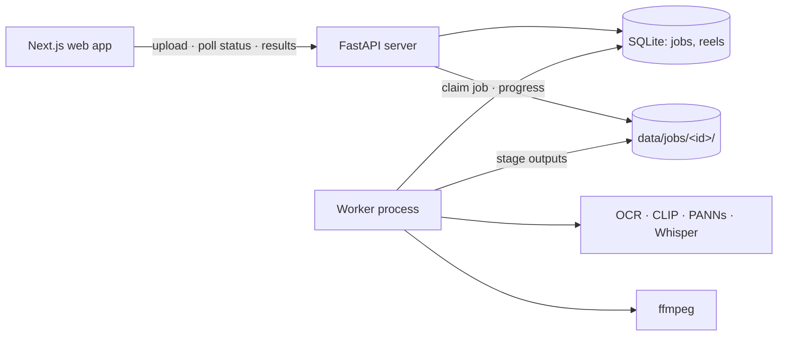

# Architecture — Reel: Automatic Football Highlight Generator

> Descriptive, not persuasive. The "why" for non-obvious choices lives in [`decisions/`](decisions/).
> Requirements: [`PRD.md`](PRD.md) · Background: [`research.md`](research.md)
>
> **Checked on real footage in slice 38** ([report](../eval/reports/assumptions.md)): the clock was found on 5 of 5 broadcasts. The score graphic does **not** hide during replays, so replays aren't used in the MVP ([ADR-007](decisions/ADR-007-no-replay-signal.md)). Crowd-audio peaks matched 11 of 14 goals but only 22 of 52 shots on target.

## Stack
- **Frontend:** Next.js (App Router) + TypeScript + Tailwind CSS + shadcn/ui; native HTML5 `<video>`; Recharts for the excitement chart.
- **Backend:** Python 3.11, FastAPI + Uvicorn, Pydantic models, `uv` for dependency management.
- **Worker:** a separate Python process (`python -m reel.jobs.worker`) that runs the pipeline, one job at a time.
- **Database:** SQLite (jobs and reels tables only). Everything else is files under `data/`.
- **Hosting:** none. Runs on the developer's laptop (localhost). SoccerNet footage is never processed on Colab or other cloud services.
- **Media:** ffmpeg / ffprobe (system binaries, called via subprocess).
- **Models (pretrained, CPU):**
  - OCR: RapidOCR (PaddleOCR PP-OCR models on ONNX Runtime).
  - Camera-shot type: CLIP ViT-B/32 via `open_clip` + a scikit-learn logistic-regression classifier trained on CLIP embeddings.
  - Crowd audio: PANNs CNN14 via `panns_inference` (AudioSet classes: Cheering, Applause, Crowd).
  - Commentary: faster-whisper (int8, CPU), only around candidate moments.
  - Camera-cut detection: PySceneDetect detectors run on low-resolution frames.
  - Loudness: librosa.
- **Testing:** pytest. Test videos are generated synthetically with ffmpeg; no real match footage is ever needed for tests.
- **Other services:** none. No cloud APIs at runtime; models are downloaded once into `data/models/`.

## System flow



- The browser talks to FastAPI directly (CORS for `localhost:3000`); uploads never pass through Next.js.
- The API only creates jobs, reports status and serves files. All heavy work happens in the worker.
- The frontend polls `GET /api/jobs/{id}` every 2 s while a job runs.

## Processing pipeline
Each stage reads earlier stages' files and writes its own into `data/jobs/<id>/`. A stage whose output file already exists and is valid is skipped. This makes it possible to resume after a crash, re-cut reels cheaply, and develop stages independently against saved files.

| # | Stage | Module | Does | Writes |
|---|---|---|---|---|
| 1 | `ingest` | `ingest` | ffprobe metadata; extract audio as 32 kHz mono WAV | `meta.json`, `audio.wav` |
| 2 | `locate_scorebox` | `scoreboard` | Seek to ~80 frames across the match; full-frame OCR; find a position whose text is a running clock; find the score next to it | `scorebox.json` (box, clock box, confidence, sample reading, or `found: false`), `scorebox_preview.jpg` |
| 3 | `scan` | `ingest` | **The only full decode of the video.** One ffmpeg pass outputs (a) 4 fps low-res frames → camera-cut detection + one keyframe per shot; (b) 2 fps full-res crops of the score box (skipped if not found) | `shots.json` (boundaries), `keyframes/`, `score_crops/` |
| 4 | `read_score` | `scoreboard` | OCR only on crops whose score area changed, ignoring the clock; read the clock every 30 s; goal state machine; halves; visibility timeline | `score_readings.json`, `score_timeline.json`, `score_events.json` |
| 5 | `classify_shots` | `shots` | CLIP embedding per keyframe → classifier → `wide` / `medium` / `close_up` / `crowd` / `graphic` with probabilities | `shot_embeddings.npy` (cache), `shots.json` (labelled) |
| 6 | `audio` | `audio` | Per-second excitement: loudness and PANNs crowd probability, each compared with a rolling 5-min baseline, combined in [0,1] | `excitement.csv` |
| 7 | `moments` | `moments` | Merge goal events and excitement peaks into candidate moments; find each moment's time and play start | `moments.json` |
| 8 | `commentary` | `audio` | Transcribe short windows around the top candidates; match keywords that give an event type | `commentary.json` |
| 9 | `highlights` | `highlights` | Rate each moment with the rules; attach reasons; compute clip start/end; select clips for the requested mode | `events.json`, `reel_plan_<mode>.json` |
| 10 | `render` | `render` | Cut each clip (re-encode, 720p H.264/AAC), draw the caption, 0.3 s fade in/out, generate the title card, concatenate | `reel_<mode>.mp4`, `clips/`, `summary.json` |

The default 5-minute reel runs stages 1–10. Requesting another mode re-runs only stages 9–10: the API creates a queued `Reel` row, and the worker claims queued reels the same way it claims jobs.

### Score-graphic detection (stage 2)
- **The clock is the anchor.** A clock token is `M:SS`, `MM:SS` or `MMM:SS` with seconds < 60, optionally followed by `+N`.
- A candidate position must show a clock token in **≥ 40%** of sampled frames.
- **Linearity check:** for consecutive samples of a candidate, the clock must move forward by 0.9–1.1× the video time, ±1 s because the clock shows whole seconds, in **≥ 70%** of pairs (half-time jumps are excluded by the rest of the pairs passing). This rejects static text and countdowns.
- The **score** is the pair of integers (0–15) next to the clock, separated by `-`, `:`, `|` or nothing, between optional team codes. OCR may return these as one line or as separate items; both must parse. OCR often reads 0 as the letter O (`ARSO-O`, `OM OO PARIS SG`), which counts as 0 unless it follows a letter. "Next to" means on the clock's line within 8 text heights, or on the line just above or below it. A candidate needs a readable score beside it in ≥ 20% of the samples where its clock was read; this is low because some fonts' zeros are often unreadable (a real 0-0 half gave a readable score in under 40% of samples).
- `clock_box` is the OCR rectangle of the clock. When OCR merges clock and score into one item, `clock_box` is the clock's share of that item, estimated from the clock's character position. Its right edge is set by the seconds digit: the pixels that change on ≥ 80% of frame pairs 1 s apart.
- If no position qualifies, `found: false`; stages 4 and the goal part of 7 are skipped, and highlights use audio + video signals only. The result page shows a notice.

### Goal state machine (stage 4)
- **OCR skip:** a crop is OCR'd only if its pixels **outside `clock_box`** changed, after a 5 px blur and ignoring the padding border, which shows live video; this keeps compression flicker from counting. OCR always sees the whole score box, never a crop of only the clock. A crop is also OCR'd every `clock_read_s` (30 s) to read the clock, which is interpolated between reads within one unbroken stretch of the graphic being visible, never across a gap such as half-time.
- Change-triggered OCR runs at most every 2 s, because see-through graphics change all the time, and a hidden graphic leaves live video in the crop. A crop that matches the last visible crop again is read at once.
- Crops are OCR'd 3× enlarged, with the detector's longest side capped. RapidOCR's default enlarges a 30 px crop about 24 times, which was slower and misread zeros on a real broadcast. A visible crop whose score can't be read is OCR'd again with the default setting, because the two fail on different broadcasts. If it's still unreadable, the reading is visible with `home`/`away` null, and the goal state machine skips it.
- A new score is accepted only after it appears in **≥ 3** readings and in **≥ 2 separate OCR results** (different raw text), or holds for 45 s (1.5 clock reads) when the clock is frozen. Readings are copied from crop to crop until the crop changes, and on the dev matches every misread that looked like a goal was one OCR result copied to 4–9 readings. The goal is dated to the new score's first reading. A first reading of 0-0 needs no confirmation; any other opening score is adopted without an event.
- Exactly one side rises by exactly 1 per change; anything else is rejected as an OCR error. A score that rose by more than one goal and holds for 300 s is adopted without events, so a missed goal doesn't block every later one.
- One side dropping by exactly 1 within 300 s of that side's goal → the goal is marked `overturned`.
- **Halves:** each reading's clock is compared with the half's clock line, the median clock-minus-time over the last 60 s. A new half starts where the clock jumps back, or comes back after ≥ 10 s hidden more than 60 s off the line, and stays on the new line for 60 s; a misread clock doesn't. A clock that stops for ≥ 5 min while visible is also a break. If only one half is found and its clock passes 45:00 and runs on for 10 min, it splits there: SoccerNet cuts each half at 45:00, so a joined match has no break. `in_play(t)` is true between the first and last clock reading of a half; pre-match and half-time are excluded from moments. Hidden in-play readings take their clock from the half's line. If the box was not found, the whole video counts as in play.
- Readings while the box is hidden are recorded as `visible: false`, not as errors.
- Events emitted: `goal`, `goal_overturned`, `half_start`.

### Moments (stage 7)
A moment comes from either of two sources; sources within `merge_window_s` (25 s) become one moment.
- **Goal:** each `goal` event. `t_moment` = the excitement maximum in [score change − `goal_lookback_s` (90 s), score change], because the graphic updates after the goal. With no audio, `t_moment` = score change − `default_goal_lag_s` (20 s).
- **Audio peak:** a local maximum of 3 s-smoothed excitement with prominence ≥ `peak_prominence` and ≥ `peak_min_gap_s` (30 s) from a stronger peak.

Replays are not a source: the score graphic stays on during them ([ADR-007](decisions/ADR-007-no-replay-signal.md)). `play_start_s` = start of the earliest unbroken run of `wide`/`medium` shots ending at or after `t_moment`, limited by the clip pre-roll.

### Commentary (stage 8)
- Transcribes [`t_moment` − 8 s, `t_moment` + 12 s] for every goal and the top `commentary_top_k` (60) other moments by excitement. Never the full audio.
- Language is checked first on 5 windows. If it isn't English, the stage writes `language` and no keywords, and non-goal moments stay type `moment`.
- Keywords in config, by type: `penalty` ("penalty", "spot kick"), `red_card` ("red card", "sent off"), `chance` ("what a save", "great save", "off the post", "hits the bar", "crossbar", "so close", "just wide"), `yellow_card` ("yellow card", "booked").
- Precedence when several match: `goal` > `penalty` > `red_card` > `chance` > `yellow_card`.

### Highlight rules (stage 9)
All values are configurable in `config/default.yaml`.

| Event | Base importance |
|---|---|
| Goal | 1.0 (always selected if the length allows) |
| Penalty (not scored) | 0.85 |
| Red card | 0.85 |
| Chance | 0.65 |
| Yellow card | 0.3 |
| Moment (high excitement, type unknown) | 0.4–0.7 from excitement |

Bonuses: crowd excitement +0.0–0.2; from the 80th minute with the score within one goal +0.1; commentary keyword matched +0.1. Every event stores the reasons that produced its score.

A non-goal moment needs excitement ≥ `moment_min_excitement`. Keyword-typed events still have to pass this test, so "that should have been a penalty" during quiet play creates nothing.

**Clip boundaries** (seconds around `t_moment`).

| Type | Pre-roll | Post-roll | Cap |
|---|---|---|---|
| Goal | 20 | 25 | 45 |
| Penalty | 20 | 20 | 30 |
| Chance | 12 | 10 | 25 |
| Red / yellow card | 10 | 12 | 25 |
| Moment | 12 | 10 | 25 |

Start = max(`play_start_s`, `t_moment` − pre-roll). End = `t_moment` + post-roll. Never crosses a half boundary.

**Selection.** Modes `3min`, `5min`, `10min`, `all`:
1. Add goals first, then other events by importance, until the target length would be exceeded (title card and fades included).
2. Allow ±15 s of the target length.
3. `all` = every goal, penalty, red card and chance, plus `moment` events when the score box wasn't found.
4. Selected clips play in match order. Overturned goals are never selected.

## Modules
Split by domain. Each module only reads/writes the stage files listed above and the shared models in `common`.

- `common` — config loading, Pydantic models for every stage file, job paths, logging. **Changes need both people's agreement.**
- `jobs` — SQLite job store, worker loop, pipeline runner.
- `api` — FastAPI routes, upload streaming, file serving with HTTP Range support.
- `ingest` — video metadata, audio extraction, the single full scan.
- `scoreboard` — locate the score graphic, OCR, goal state machine, halves, visibility timeline.
- `shots` — camera-cut detection, shot labelling (CLIP + classifier), classifier training script.
- `audio` — excitement-over-time series, commentary keywords.
- `moments` — candidate-moment generation.
- `highlights` — rating rules, reasons, clip boundaries, selection.
- `render` — captions, title card, clip cutting, concatenation.
- `frontend` (Next.js) — upload page, progress page, results page, past matches page.
- `eval` — SoccerNet label loader, match preparation, metric scripts, ablation runs. Not imported by the app.

Ownership: Dev A — `common`, `jobs`, `ingest`, `scoreboard`, `moments`, `highlights`, `eval`; Dev B — `shots`, `audio`, `render`, `api`, `frontend`, test fixtures.

### Repo layout
```
backend/
  pyproject.toml
  config/default.yaml
  reel/{common,jobs,api,ingest,scoreboard,shots,audio,moments,highlights,render}/
  tests/                 # pytest; tests/fixtures/make_synthetic.py builds test videos
frontend/                # Next.js app
eval/
  soccernet/             # downloaded labels (gitignored)
  manifests/             # which SoccerNet games are dev/test — committed
  reports/
data/                    # gitignored: videos, jobs/<id>/, models/
docs/
```

## API contract
Base URL `http://127.0.0.1:8000`. JSON unless noted.

| Method | Path | Request | Response |
|---|---|---|---|
| PUT | `/api/uploads?filename=…` | raw video bytes (streamed to disk) | `{ upload_id, filename, size_bytes }` |
| POST | `/api/jobs` | `{ upload_id }` or `{ local_path }` | `{ job_id }` |
| GET | `/api/jobs` | — | `[{ job_id, filename, status, created_at, duration_s }]` |
| GET | `/api/jobs/{id}` | — | `{ job_id, status: queued\|running\|done\|failed, stage, progress: 0–100, error?, created_at, filename }` |
| GET | `/api/jobs/{id}/result` | — | `{ summary, scorebox, events: Event[], reels: Reel[] }` (see Data model) |
| GET | `/api/jobs/{id}/excitement` | — | `{ step_s: 1, values: number[], markers: [{ t, type, event_id }] }` |
| POST | `/api/jobs/{id}/reels` | `{ mode: 3min\|5min\|10min\|all, exclude_event_ids?: string[] }` | `{ mode, status }` |
| GET | `/api/jobs/{id}/reels/{mode}` | — | `{ mode, status, url?, duration_s?, exclude_event_ids, clips?: [{ event_id, offset_s, duration_s }] }` |
| GET | `/api/files/{id}/{path}` | `Range` header supported | file bytes (video / image / JSON) |
| POST | `/api/jobs/{id}/scorebox` *(should-have)* | `{ x, y, w, h }` in source pixels | `{ job_id, status }` (re-runs from stage 3) |

Errors: `{ error: { code, message } }` with 4xx/5xx. `stage` values: `ingest`, `locate_scorebox`, `scan`, `read_score`, `classify_shots`, `audio`, `moments`, `commentary`, `highlights`, `render`.

## Data model
**SQLite**
- `Job` — `id`, `status`, `stage`, `progress`, `input_path`, `source` (`upload`/`local`), `filename`, `duration_s`, `created_at`, `started_at`, `finished_at`, `error`. Has many `Reel`.
- `Reel` — `job_id`, `mode`, `status`, `path`, `duration_s`, `event_ids` (JSON), `exclude_event_ids` (JSON). Unique per (`job_id`, `mode`).

**Stage files (Pydantic models in `common`)**
- `Scorebox` — `found`, `box: [x, y, w, h]?`, `clock_box: [x, y, w, h]?`, `confidence`, `sample_reading?`, `sample_time_s?`, `preview_url?`.
- `ScoreReading` — `time_s`, `raw_text`, `home_code?`, `away_code?`, `home?`, `away?`, `clock_s?`, `confidence`, `visible`.
- `ScoreTimelineEntry` — `time_s`, `home`, `away`, `visible`, `half`, `clock_s?`, `in_play`.
- `ScoreEvent` — `type` (`goal`/`goal_overturned`/`half_start`), `time_s`, `side` (`home`/`away`)?, `home`, `away`, `half`, `clock_s?`, `overturned`.
- `Moment` — `id`, `half`, `minute` (e.g. `"67"`, `"45+2"`, may be null), `t_moment_s`, `play_start_s`, `sources` (`goal`/`audio`), `goal` (bool), `side?`, `overturned`, `score_after` (e.g. `"ARS 2-1 CHE"`), `excitement_max`.
- `Event` (in `events.json`, returned by `/result`) — `id`, `moment_id`, `type` (`goal`/`penalty`/`red_card`/`chance`/`yellow_card`/`moment`), `half`, `minute`, `score_text`, `importance` (0–1), `confidence` (0–1), `reasons: [{ signal, value, label }]`, `moment_s`, `clip: { start_s, end_s }`, `overturned`.
- `summary` — `teams?`, `final_score?` (`"ARS 2-1 CHE"`), `halves: [{ home_goals, away_goals }]`, `moments_found`, `processing_s`, `scorebox_found`, `stage_timings`.

**Job directory**
```
data/jobs/<id>/
  input.<ext> (or a reference to local_path)   meta.json  audio.wav
  scorebox.json  scorebox_preview.jpg  shots.json  keyframes/  score_crops/
  score_readings.json  score_timeline.json  score_events.json
  shot_embeddings.npy  excitement.csv
  moments.json  commentary.json  events.json  reel_plan_<mode>.json
  clips/  reel_<mode>.mp4  title.png  summary.json
```

## Evaluation
Ground truth is SoccerNet-v2 `Labels-v2.json`: per half, `gameTime` (`"1 - 13:10"`), `position` (ms into that half's video), `label`, `team`, `visibility`. `Labels-cameras.json` gives camera type and a `replay` flag per shot.

SoccerNet videos are one file per half. `eval` joins them into one file for a job and shifts second-half label times by the first file's duration.

**Key actions** are the labels `Goal`, `Penalty`, `Red card`, `Yellow->red card` and `Shots on target`.

| ID | Measures | Definition |
|---|---|---|
| E0 | Graphic found | Share of matches with `found: true` |
| E1 | Goals | Precision/recall of `goal` events against `Goal` labels; a match needs `t_moment` within ±30 s of the label |
| E2 | Key actions | Recall of key actions by `all`-mode events within ±15 s |
| E3 | Goal clips | Share of `Goal` labels whose clip covers label − 3 s to label + 3 s |
| E4 | Ablation | E1–E3 and E5 with signals switched off: audio → + shots → + commentary → + score |
| E5 | Reel quality | Share of 5-minute-reel clips containing a key action, compared with random clips of the same count and lengths from in-play time (seeded, 20 draws) |
| E6 | Viewer survey | Only if footage rights allow |
| — | Runtime | `summary.processing_s` per match |

## Configuration
- `backend/config/default.yaml` — all thresholds, weights, clip rules and sampling rates, plus `signals.{score,shots,audio,commentary}: true|false` switches used for the ablation evaluation.
- Environment variables (names only, see `.env.example`): `REEL_DATA_DIR`, `REEL_MODELS_DIR`, `REEL_API_HOST`, `REEL_API_PORT`, `NEXT_PUBLIC_API_URL`.

## Testing
- Synthetic fixtures: `tests/fixtures/make_synthetic.py` uses ffmpeg to generate short videos: coloured pitch and crowd scenes with hard cuts, a drawn score graphic with a running clock and a score that changes on a known schedule (including a hidden-box replay, an overturned goal and a half-time break), and audio with bursts at known times. Tests assert against the known schedule.
- Every module is tested on its stage file inputs/outputs, so tests don't need earlier stages to run.
- Real footage is used only in `eval/`, locally.

## Constraints
- **Scale:** single user, localhost only (API binds to `127.0.0.1`), one job running at a time. No auth.
- **Performance:** CPU only. A full match (~2 h, 720p) must finish in ≤ 60 min on a laptop. Re-cutting a reel in another mode should take ≤ 5 min. The video is fully decoded once (stage 3). Memory must stay bounded: stream frames, never load the whole video.
- **Data:** match videos and job outputs stay in `data/` (gitignored), are never committed and never sent to any external service. Models are downloaded once to `REEL_MODELS_DIR`. SoccerNet rules in [ADR-006](decisions/ADR-006-soccernet-eval-and-footage-rules.md) apply.
- **Reproducibility:** the same input and config produce the same `events.json` (fixed seeds, deterministic ordering).
- **Not needed:** live streams, multiple concurrent jobs, accounts, cloud deployment, GPU support, Docker/CI (unless explicitly requested), mobile layouts beyond basic responsiveness.

---

**Exit check:** Could a coding agent read this and know which module a new slice belongs in, without asking you?
